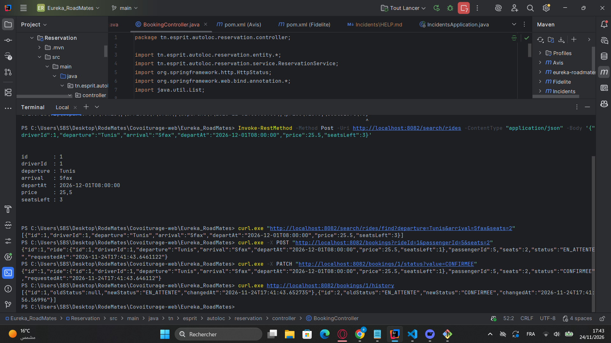

# 🚗 RoadMates – Covoiturage Web

Architecture Web Distribuée – Atelier Eureka & Actuator
Année universitaire : 2026–2027

## 👥 Équipe :

Eya Allah Romdhani       --> Recherche & Réservation

Omaima Zaghouani         --> Trajets

Mohamed Aziz Bouslama    --> Avis & Réputation

Rayen Samoud             --> Fidélité & Récompenses

Mohamed Hedi Mehdoui     --> Paiement

Fedi Mouelhi             --> Incidents & Accidents

Eya Allah Romdhani       --> Notification & Messagerie (microservice partagé)

⚙️ Prérequis

JDK 17 ou supérieur

Maven (ou le wrapper mvnw fourni)

IntelliJ IDEA

Docker Desktop

PostgreSQL

MongoDB

Spring Boot 3.5.7

Spring Cloud 2025.0.0

🚀 Lancer le projet

Ordre de démarrage

Démarrer Docker Desktop et les conteneurs pg et mongo.

Lancer le serveur Eureka (EurekaRoadMatesApplication) sur le port 8761.

Lancer les microservices dans n'importe quel ordre.

Dashboard Eureka

Accédez au dashboard depuis votre navigateur :

http://localhost:8761

# 📸 Eureka Dashboard

# Test du CRUD – Recherche & Réservation

📁 Structure du dépôt
Covoiturage-web/
├── BackEnd/
├── FrontEnd/
├── Documentation/
├── images/                 ← captures d'écran 
└── Eureka_RoadMates/
    ├── src/                ← serveur Eureka
    ├── pom.xml
    ├── Trajets/
    ├── Reservation/
    ├── Paiement/
    ├── Fidelite/
    ├── Avis/
    ├── Incidents/
    └── Notification/

